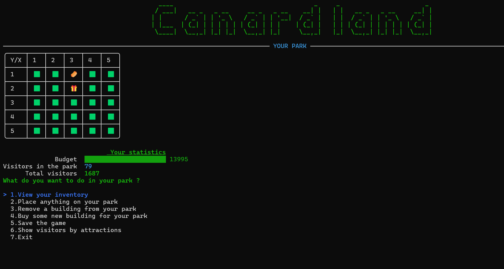

# ?? Canard Land - Jeu de gestion de parc d’attractions


**Amusement Park** est un jeu console codé en **C#** qui vous plonge dans la peau d’un gestionnaire de parc d’attractions. Il utilise la bibliothèque **[Spectre.Console](https://spectreconsole.net/)** pour une interface console avancée et stocke les données via **SQLite** pour persister l'état du parc.

---

## ? Fonctionnalités

- ??? **Placer et retirer des bâtiments** (attractions, boutiques, etc.)
- ?? **Acheter de nouveaux bâtiments** via une boutique intégrée
- ?? **Voir votre inventaire de structures**
- ?? **Visualiser les statistiques** : budget, visiteurs, historique
- ?? **Sauvegarder la partie**
- ??? **Afficher les visiteurs par attraction**
- ??? **Persistance des données avec SQLite**

---

## ?? Aperçu du jeu

Le jeu se joue dans le terminal, avec une interface colorée et interactive :

```

+----+----+----+----+----+
| Y/X| 1  | 2  | 3  | 4  | 5  |
| 1  | ?? | ?? | ?? | ?? | ?? |
| 2  | ?? | ?? | ?? | ?? | ?? |
...

Budget: ???????????? 13995
Visiteurs dans le parc: 79
Total des visiteurs: 1687

Que voulez-vous faire ?
1. Voir l’inventaire
2. Placer un bâtiment
3. Retirer un bâtiment
4. Acheter un bâtiment
5. Sauvegarder la partie
6. Voir les visiteurs par attraction
7. Quitter
```

---

## ??? Technologies utilisées

- **Langage** : C# (.NET 9 ou supérieur)
- **UI Console** : [Spectre.Console](https://www.nuget.org/packages/Spectre.Console)
- **Base de données** : SQLite
- **Persistance** : `System.Data.SQLite` (selon version)

---

## ?? Installation & Lancement

### ? Prérequis

- [.NET SDK 9+](https://dotnet.microsoft.com/en-us/download)
- Git (optionnel)
- SQLite installé (ou intégré via EF Core)

### ?? Lancer le jeu

```bash
git clone https://github.com/PatoucheH/AmusementParkProject.git
cd AmusementParkProject
dotnet build
dotnet run
```

---

## ?? Structure du projet

```
AmusementParkProject/
???? AmusementPark
?		???? Models/              # Modèles : Parc, Bâtiments, Attractions
?		???? Data/                # Gestion de la base de données SQLite
?		???? Services/            # Logique métier (gestion visiteurs, budget, etc.)
?		???? Utils/               # Fonctions utilitaires (menu, musique)
?		???? Program.cs           # Point d'entrée principal
???? Test_AmusementPark
```

---

## ?? Sauvegarde & Données

Les sauvegardes sont persistées automatiquement en base SQLite, vous permettant de reprendre votre partie plus tard.

- ?? Base localisée dans `Data/park.db` 
- ?? Les visiteurs, bâtiments et budget sont liés à l’état du parc

---

## ?? Objectif du jeu

Gérez votre budget, attirez un maximum de visiteurs et construisez le parc d’attractions ultime ! Chaque bâtiment influence vos revenus et le nombre de visiteurs.

---

## ?? Licence

Ce projet est réalisé dans le cadre d’un apprentissage personnel. Libre à vous de le modifier, étendre ou forker.

---

## ?? Auteurs

Développé avec ?? en C# par [@PatoucheH](https://github.com/PatoucheH)

---

## ?? Capture d'écran



---

Bon jeu ! ??????
